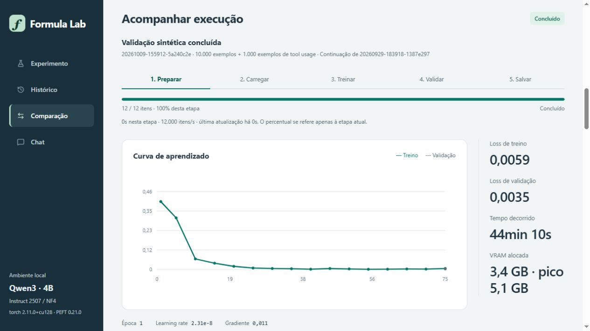
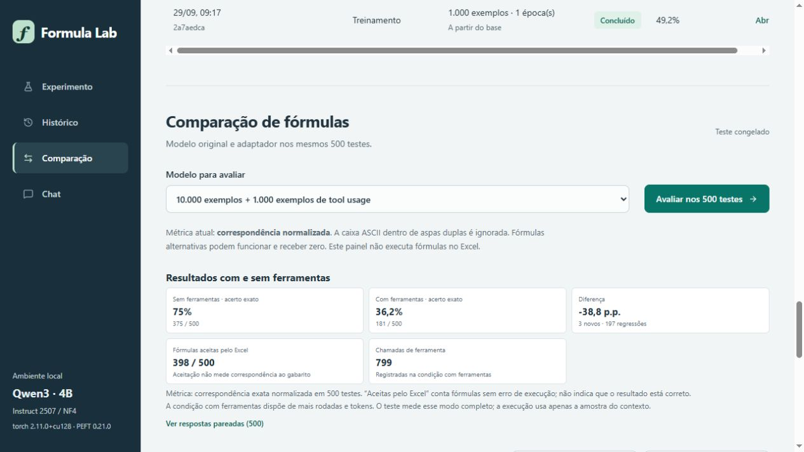
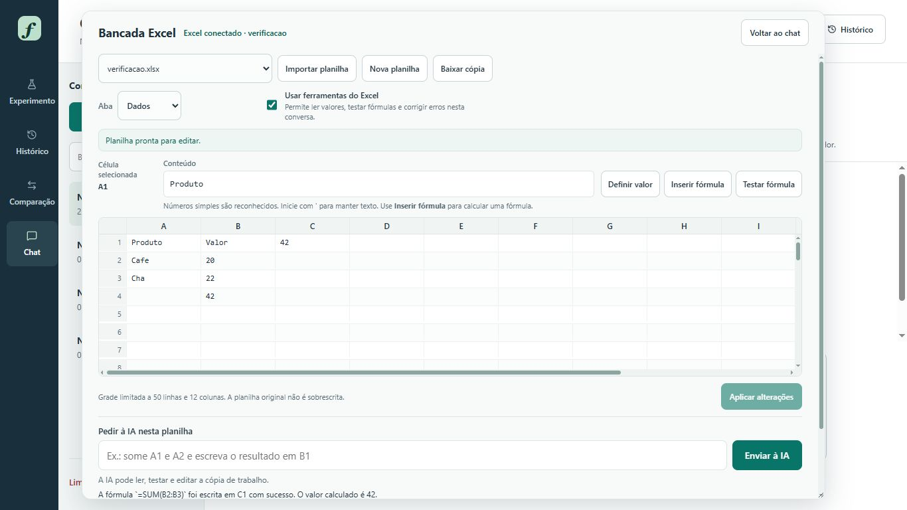

# Formula Lab — Qwen para fórmulas de Excel

Painel local em HTML, CSS e JavaScript para preparar dados, treinar adaptadores QLoRA e avaliar o `Qwen/Qwen3-4B-Instruct-2507`. O servidor usa a biblioteca padrão do Python; não precisa de Node, npm, CDN ou serviços externos para funcionar.

Os [resultados versionados](resultados/README.md) incluem parâmetros, curvas de loss e avaliações por ID. A [análise dos experimentos](resultados/ANALISE.md) explica cada resultado, as falhas observadas e os limites das comparações. Veja também as [capturas reais do painel](#telas-do-painel).

## Instalar do zero no Windows

O instalador configura **Python 3.12, uv, PyTorch 2.11 com CUDA 12.8 e todas as dependências fixadas em `uv.lock`**. Também baixa os pesos da revisão usada pelo projeto e prepara os dados de treino, validação e os 500 testes. Não é necessário instalar Python, pip, Git, Node.js ou o CUDA Toolkit antes.

### Requisitos do computador

- Windows 10/11 de 64 bits, arquitetura x64, com PowerShell 5.1 ou posterior.
- Para **chat e treinamento**, GPU NVIDIA compatível com CUDA e bfloat16, com 8 GB de VRAM ou mais. O consumo varia com o contexto e os parâmetros. Reserve pelo menos 16 GB de RAM e 30 GB livres em disco; contextos longos se beneficiam de mais RAM.
- **Driver NVIDIA instalado e compatível com CUDA 12.8.** O driver depende da placa e deve ser obtido no [site oficial da NVIDIA](https://www.nvidia.com/Download/index.aspx?lang=pt-br). O instalador verifica a comunicação com a GPU e informa quando o driver não está pronto. O CUDA Toolkit é dispensável para os pacotes binários usados aqui.
- **Microsoft Excel de desktop instalado e licenciado** para ler, testar e editar planilhas pelo Excel. O chat e o treino não exigem Excel. A aplicação não instala nem ativa o Office; [instalação oficial do Microsoft 365](https://support.microsoft.com/pt-br/office/baixar-instalar-ou-reinstalar-o-microsoft-365-ou-o-office-2024-em-um-computador-ou-mac-4414eaaf-0478-48be-9c42-23adc4716658).
- Internet durante a configuração. Depois que pesos e dados estiverem no cache local, o painel funciona localmente. O download do modelo ocupa vários GB.

### Copiar e executar estes comandos

Abra o **PowerShell**. Este caminho baixa o projeto em ZIP, então também funciona sem Git:

```powershell
$arquivo = Join-Path $env:TEMP "formula-lab.zip"
Invoke-WebRequest -UseBasicParsing -Uri "https://github.com/pebarone/formula-lab/archive/refs/heads/main.zip" -OutFile $arquivo
New-Item -ItemType Directory -Path "$HOME\Projetos" -Force | Out-Null
Expand-Archive -LiteralPath $arquivo -DestinationPath "$HOME\Projetos"
Set-Location "$HOME\Projetos\formula-lab-main"
powershell -NoProfile -ExecutionPolicy Bypass -File .\configurar.ps1
.\abrir_painel.bat
```

Se a pasta `formula-lab-main` já existir, entre nela e execute apenas as duas últimas linhas. O comando de expansão não sobrescreve um projeto existente. A primeira instalação pode demorar devido aos pesos e ao PyTorch; o progresso aparece no terminal. Os downloads de dados são conferidos por tamanho e SHA-256 e podem ser retomados executando o script novamente.

O `uv` é obtido do [instalador oficial da Astral](https://docs.astral.sh/uv/reference/installer/) quando não estiver disponível e fica em `.tools/uv/`. O Python gerenciado fica no cache do uv e os pacotes do projeto ficam em `.venv/`. O script não altera a política permanente de execução nem o PATH do sistema. Se faltar o runtime do Visual C++, ele obtém o instalador oficial da Microsoft; o Windows pode solicitar permissão de administrador.

### O que acontece se já estiver instalado

É seguro executar o script novamente. Ele procura o runtime do Visual C++, o uv no PATH ou em `.tools/uv/`, um Python 3.12 compatível e o ambiente escolhido. O uv mantém os pacotes de `.venv` que já correspondem a `uv.lock`, instala somente os ausentes ou com versões diferentes e preserva pacotes extras. Os arquivos brutos do dataset são reutilizados quando tamanho e SHA-256 conferem; a conversão canônica é refeita. O modelo completo no cache é conferido e reutilizado sem consultar a rede.

Python já instalado pode fornecer o interpretador do ambiente; pacotes globais de outros projetos não são alterados nem copiados para `.venv`. O isolamento evita conflitos. Uma versão incompatível de Python ou de um pacote não substitui a versão exigida pelo projeto.

As mensagens deixam as decisões visíveis, por exemplo:

```text
[Reutilizar] Runtime do Visual C++ já encontrado; nenhuma instalação necessária.
[Reutilizar] uv já encontrado no PATH: ...
[Conferir] Ambiente existente em ...; pacotes compatíveis serão mantidos.
Checked 62 packages in 4ms
[Reutilizar] train.json: tamanho e SHA-256 conferidos.
[Reutilizar] Modelo e tokenizer completos no cache local: Qwen/...
```

Quando faltar um componente, aparecerá `[Baixar]` ou `[Criar]`. A repetição completa foi testada com uv e Hugging Face em modo offline, sem reinstalar os pacotes que já correspondiam ao arquivo de versões.

Alternativa para quem já possui Git:

```powershell
git clone https://github.com/pebarone/formula-lab.git
Set-Location formula-lab
powershell -NoProfile -ExecutionPolicy Bypass -File .\configurar.ps1
.\abrir_painel.bat
```

### Conferir ou preparar em etapas

```powershell
# Somente conferir uma instalação já pronta, sem baixar ou sincronizar pacotes.
powershell -NoProfile -ExecutionPolicy Bypass -File .\configurar.ps1 -SomenteVerificar

# Instalar o ambiente e testar o painel sem baixar pesos/dados nem exigir uma GPU.
powershell -NoProfile -ExecutionPolicy Bypass -File .\configurar.ps1 -SemModelo -SemDados -SemVerificarGPU -ComTestes

# Baixar depois os pesos e os dados, usando o ambiente já instalado.
.\.venv\Scripts\python.exe -m tools.preparar_ambiente
.\.venv\Scripts\python.exe -m tools.verificar_ambiente --exigir-gpu

# Testar a instalação em outro ambiente, mantendo a .venv de trabalho.
powershell -NoProfile -ExecutionPolicy Bypass -File .\configurar.ps1 -Ambiente .venv-teste -SemModelo -SemDados -SemVerificarGPU -ComTestes
```

`-SemVerificarGPU` não habilita inferência em CPU: permite instalar e testar a interface em uma máquina sem GPU. Para gerar respostas ou treinar, configure o driver e execute a verificação completa. A configuração sem modelo/dados prepara o painel, mas essas operações continuam indisponíveis até o download.

### Arquivos que não acompanham o GitHub

Um clone novo começa com o modelo base e sem pesos de adaptadores treinados. Os [resultados históricos publicados](resultados/README.md) podem ser consultados sem GPU, mas não são importados automaticamente para o histórico de novas execuções. Planilhas, conversas e adaptadores criados no computador ficam em `runs/`. Pesos ficam no cache do Hugging Face. Os dados NL2Formula são baixados diretamente da fonte e convertidos localmente, pois a fonte não declara uma licença única de redistribuição. Consulte [proveniência dos dados](dataset/README.md) e [componentes e arquivos locais](AVISOS.md).

Os scripts históricos de experimentos e de treino de ferramentas podem exigir os pesos dos adaptadores citados nos relatórios. Os pesos não são distribuídos. Os parâmetros, manifestos e métricas disponíveis foram publicados em `resultados/`. Para começar em outro computador, use o **modelo base** ou treine um novo adaptador pelo painel.

## Abrir o painel

Depois da configuração, dê dois cliques em **`abrir_painel.bat`**, ou execute:

```powershell
.\.venv\Scripts\python.exe -m dashboard.server --open
```

O navegador abre em **http://127.0.0.1:8765**. O painel aceita somente conexões locais. Fechar a aba não interrompe uma execução; use **Interromper** no painel para cancelar. Os processos e resultados podem ser recuperados ao reabrir o servidor.

## Primeiro experimento

1. Mantenha os valores iniciais: **5.000 exemplos de treino, 500 de validação, 1 época**, learning rate `0.0001`, batch `1`, acumulação `16`, sequência máxima `1024`, LoRA rank `8` e alpha `16`.
2. Clique em **Verificar dados**. A seleção usa seed `42`, intercala dificuldades proporcionalmente e confere IDs e separação de tabelas entre os splits. Essa etapa usa o tokenizer local, sem carregar o modelo na GPU.
3. Confira no painel as quantidades, tabelas, exclusões e tamanhos de sequência. Clique em **Iniciar treino**. A preparação é refeita deterministicamente com os parâmetros escolhidos, sem depender de arquivos temporários de outra execução.
4. Acompanhe as etapas **Preparar → Carregar → Treinar → Validar → Salvar**. Treino e validação mostram exemplos processados, velocidade, tempo da etapa e estimativa restante. O treino também mostra passos do otimizador, loss, learning rate, norma do gradiente e VRAM. Carregamento e salvamento usam barra indeterminada, sem inventar percentual. A estimativa é apenas da etapa corrente; 100% do treino ainda não significa fim da execução. A validação se repete a cada época e sua loss aparece ao final. Execuções antigas não possuem contagem de validação.
5. Em **Comparação**, selecione o treinamento concluído e clique em **Avaliar nos 500 testes**. Essa operação usa o adaptador salvo. Cada avaliação tem predições próprias, sem reutilizar o cache do baseline.

O treinamento inicia apenas ao clicar em seu botão. O teste oficial nunca é usado para treinar nem escolher checkpoints. Os parâmetros iniciais são um ponto de partida, não uma promessa de qualidade ou de consumo máximo de VRAM.

Em **Comparação**, mudar **Modelo para avaliar** também mostra a avaliação concluída mais recente daquele modelo, sem iniciar uma nova execução. Se o adaptador ainda não tiver resultado, o painel informa isso e limpa as métricas anteriores. Para o modelo base, usa o baseline salvo quando não há uma avaliação posterior. **Ver respostas** no ponto de partida abre o baseline original; abrir uma avaliação pelo histórico mostra aquela execução e ajusta o seletor ao modelo correspondente.

Nos experimentos locais, o baseline regenerado nos 500 testes obteve 3/500 (0,6%), com batch 1 e pico reservado de 6,396 GiB. A [cópia publicada do baseline](resultados/execucoes/baseline-refresh-20261001T020305Z/report.json) preserva as métricas e as respostas por ID. Para gerar seu próprio baseline, siga [benchmark/README.md](benchmark/README.md). Consulte [medições e limites](training_efficiency.md).

## Continuar um adaptador

Em **Configurar treinamento → Ponto de partida**, escolha **Modelo base · novo adaptador** ou uma execução concluída. Ajuste os exemplos, épocas e learning rate e clique em **Iniciar treino**. O painel carrega o adaptador escolhido como treinável, preserva sua arquitetura LoRA (rank e alpha ficam bloqueados no formulário) e salva o resultado em uma **nova pasta de execução**. O adaptador original não é sobrescrito.

É uma nova etapa de treinamento a partir dos pesos aprendidos: o otimizador, o scheduler e a contagem de passos recomeçam. Isso não retoma o estado de um checkpoint interrompido. O ID de origem aparece no histórico, no monitor e nos arquivos `request.json` e `training_summary.json`. A nova versão pode ser selecionada para outro treino, para avaliação e no chat.

A opção **Usar apenas exemplos novos ao continuar** vem marcada. Ela exclui os IDs de treino do adaptador escolhido e de **toda a sua cadeia de origem**, mesmo que etapas anteriores tenham permitido repetições. Assim, continuar um adaptador de 10.000 exemplos com mais 10.000 seleciona outros 10.000 IDs. A exclusão se aplica àquela linhagem; treinos independentes não consomem o dataset globalmente. A validação permanece separada e pode se repetir. A garantia é por ID do dataset, não por semelhança de conteúdo.

**Verificar dados** considera o mesmo adaptador e filtros de **Iniciar treino**. O manifesto `selection.json` registra IDs, execuções de origem e contagem dos exemplos já usados excluídos. Se faltarem exemplos elegíveis, o processo falha antes de carregar a GPU, sem completar a quantidade com repetições. Manifestos ausentes, dataset/prompt incompatíveis e ciclos na cadeia também bloqueiam a seleção. Desmarque a opção para repetir dados intencionalmente. O dataset original permanece intacto.

## Adaptador de recusa

**Extrair adaptador de recusa** não é um QLoRA de fórmulas. O Qwen alinhado representa a recusa como uma direção no residual: a ativação do último token do prompt em pedidos que ele recusa fica deslocada em relação a pedidos comuns. O painel mede essa diferença em cada camada, descarta camadas instáveis e grava a remoção como um LoRA de rank 1 nas projeções que escrevem o residual (`o_proj` e `down_proj`). A conta é fechada, ΔW = −r rᵀ W, com escala 1. Nenhum texto de resposta é gerado e o dataset de fórmulas não entra nessa execução.

O adaptador de fórmulas continua separado. No chat, **Combinar com o adaptador de recusa** soma os dois LoRAs em cima do mesmo Qwen, sem mesclar os pesos e sem continuar um dentro do outro. Também dá para selecionar só a recusa. Em **Comparação**, o adaptador de recusa pode ser avaliado nos 500 testes; essa medição não exige manifesto de treino porque a extração não viu o dataset. O teste congelado e o prompt do baseline não mudam.

A extração parte sempre do modelo base, em NF4, e leva alguns minutos nesta GPU. Se poucas camadas tiverem uma direção estável, a execução falha e não salva o adaptador; `decensor_report.json` lista o cosseno de cada camada. Remover a direção deixa o modelo menos propenso a recusar, inclusive pedidos que o Qwen original recusaria. Ela não ensina fórmulas novas. Depois de combinar com um treino de fórmulas, vale repetir os 500 testes.

## Dados e métrica

- Splits originais preservados: `dataset/canonical/{train,validation,test}.jsonl`. Ao regenerar o baseline, o resultado anterior é preservado byte a byte em um arquivo histórico antes da substituição do relatório ativo.
- O filtro de funções suspeitas vem ligado. Exclui do treino e validação fórmulas com `SUMMARIZE`, `SUMX`, `AVERAGEX`, `COUNTX`, `DCOUNTX`, `MAXX` e `MINX`. É uma heurística, **não validação de execução de fórmulas**. Não modifica o teste congelado.
- Exemplos maiores que o limite de tokens são substituídos por outros exemplos elegíveis; contexto e gabarito não são truncados. O painel registra as exclusões. A filtragem por tamanho pode alterar a proporção final das dificuldades, registrada no manifesto.
- A loss usa apenas a resposta do assistente e o fechamento da mensagem. Tokens do prompt e padding recebem label `-100`.
- No treino e na validação, a projeção do vocabulário calcula somente as posições que predizem tokens supervisionados. O contexto completo continua passando pelo modelo; a loss causal e sua normalização por tokens na acumulação são preservadas. Isso evita grandes tensores de logits para posições ignoradas do prompt.
- A validação seleciona o melhor checkpoint pela menor `eval_loss`. Treinamento completo salva o adaptador desse checkpoint. Checkpoints por época guardam também o estado do otimizador; o painel permite continuar os pesos de um adaptador concluído, mas não retomar o estado do otimizador de um checkpoint.
- A avaliação mantém prompt, modelo base, NF4, double quant, bfloat16, geração gulosa e limite de 128 tokens do baseline.
- O resultado mede **correspondência exata normalizada**, não execução no Excel. Uma fórmula alternativa pode ser válida e receber zero. A comparação mostra diferença em pontos percentuais, novos acertos, regressões e as respostas individuais.
- Os hashes dos três splits e a identidade do prompt são salvos com o treinamento. Mudanças posteriores bloqueiam a comparação daquele adaptador com o dataset atual.
- Modelo e tokenizer estão fixos no snapshot `cdbee75f17c01a7cc42f958dc650907174af0554`, já usado pelos adaptadores deste ambiente. A identidade da avaliação inclui essa revisão, as entradas completas na ordem original e a receita de geração; não acompanha mudanças de `main` no cache. Resultados legados sem prova suficiente são preservados, mas não reutilizados para comparar.

## Ambiente e memória

`pyproject.toml` declara as dependências diretas e `uv.lock` fixa o ambiente completo. O instalador usa o índice oficial do PyTorch para os binários CUDA 12.8 e o PyPI para os demais pacotes. A aplicação resolve o modelo pelo cache local e não inicia downloads de pesos durante uma geração.

O arquivo `requirements-training.txt` foi usado como complemento ao ambiente de desenvolvimento antigo. Para uma máquina nova, use `configurar.ps1`; instalar somente esse arquivo não configura o projeto completo. Não sincronize pacotes durante uma execução ativa.

O treino e a avaliação dos 500 testes limitam o alocador do PyTorch a **85% da VRAM** por padrão, ou à memória livre menos 512 MiB, o que for menor, antes de carregar o modelo. A **Fração máxima da VRAM** pode ser ajustada de `0.5` a `0.95`. O limite não inclui alocações diretas de bibliotecas CUDA nem controla outros processos. Se o microbatch não couber, o treino falha com orientação para reduzir batch ou sequência. O monitor mostra memória atual e pico alocado; a dica da métrica informa memória reservada, pico reservado e orçamento. Esses dados também ficam nos eventos, no resumo final do treino e no relatório da avaliação. A lista Python de exemplos tokenizados é liberada depois da conversão para o dataset do Trainer.

Se houver falta de VRAM, mantenha batch `1`, reduza `max_length` ou, em um adaptador novo, o rank LoRA. Reduzir o limite de tokens altera a seleção de dados; confira o novo manifesto. Ajustar a acumulação muda o batch efetivo, sem aumentar o tamanho de cada microbatch. Mais exemplos aumentam principalmente a duração e o uso de RAM pelos dados; o pico de VRAM depende sobretudo do microbatch, sequência e arquitetura. Confira a [avaliação de eficiência](training_efficiency.md) com medições locais.

A avaliação dos 500 testes usa **Batch dos 500 testes**, separado do batch de treino, com padrão `1` e intervalo de `1` a `8`. O planejamento reserva também os 128 tokens possíveis de resposta no orçamento do cache. Se um lote não couber no limite, ele é dividido; um teste individual que não caiba encerra a avaliação com erro, preservando as predições já gravadas. Contextos e respostas do teste não são truncados, e prompt, geração gulosa e métrica permanecem iguais. A memória reservada pelo PyTorch pode ser maior que a alocada medida depois do lote: acompanhe também os picos. A memória compartilhada mostrada pelo Windows inclui medições do driver e não é o mesmo indicador da memória alocada do PyTorch.

## Chat com o modelo base ou treinado

Abra `http://127.0.0.1:8765/#chat` e escolha **Modelo base** ou **Último treinado**. O segundo usa o treinamento concluído mais recentemente que contenha os arquivos do adaptador; treinos em andamento, interrompidos e adaptadores parciais não entram nessa seleção. O ID e a quantidade de exemplos ficam visíveis. Essa seleção não mede qualidade: um treino curto de teste também pode ser o mais recente.

O chat gera respostas reais com o Qwen local. O modelo base é preservado; a opção treinada carrega o adaptador sobre ele, sem mesclar os pesos. O adaptador fica fixo durante a conversa. É possível selecionar o último treinamento ou uma versão específica. Trocar de modelo ou clicar em **Nova conversa** inicia outro histórico. As conversas, os rascunhos, a seleção ativa e o ID da geração pendente ficam no armazenamento local do navegador. Atualizar a página recupera a geração pelo servidor; requisições e respostas também ficam salvas localmente em `runs/`. Se o armazenamento do navegador falhar, o chat avisa e permite exportar a conversa.

### Anexar planilhas

Ao anexar XLSX, CSV ou TSV no chat, o painel importa o último arquivo enviado para a planilha editável e abre uma janela ampla. Também é possível usar **Abrir planilha** no cabeçalho ou **Ampliar planilha** na bancada. A janela pode ser redimensionada no desktop; **Voltar ao chat** devolve a mesma grade à bancada, mantendo a seleção, a revisão e as edições. A grade continua sendo uma prévia de até 50 linhas e 12 colunas; o XLSX completo e suas fórmulas permanecem na cópia de trabalho.

Use **Pedir à IA nesta planilha** para ler células, testar fórmulas e autorizar alterações pelo chat. As escritas concluídas aparecem na grade durante a resposta. Aplique edições manuais pendentes antes de pedir à IA ou importar outro arquivo. Se a importação falhar, o anexo permanece disponível e o painel mostra o erro para nova tentativa.

Resultados de avaliações com e sem ferramentas aparecem no **Histórico** e em **Comparação**, associados ao adaptador avaliado, mesmo sem a conversa original aberta. Abrir um treinamento seleciona sua avaliação concluída mais recente. Os relatórios históricos são carregados sem repetir a avaliação.

O chat limita o alocador de VRAM como o treino. Contextos maiores usam leitura em blocos de 256 tokens; acima de 8.192 tokens, o cache é transferido entre RAM e GPU com cópias síncronas, sem acumular transferências assíncronas em memória fixada do sistema. Isso preserva o contexto completo, com maior tempo de resposta. A aceleração por CUDA graph fica restrita a caches de até 2.048 tokens. Após falta de memória no alocador ou no runtime CUDA, o processo do chat termina; a próxima tentativa carrega um processo novo.

Com ferramentas habilitadas, a IA recebe os cabeçalhos e até cinco linhas de amostra de cada aba; pode consultar os demais dados com `excel_read_range`. O arquivo anexado que originou a planilha ativa não é incluído uma segunda vez no contexto. Sem ferramentas, o contexto de leitura continua usando a amostra ampliada.

Use **Anexar planilha** ou arraste arquivos para a composição. São aceitos XLSX, CSV e TSV, até três arquivos de 8 MiB por mensagem. Imagens não são aceitas: este Qwen recebe texto. CSV/TSV precisa estar em UTF-8 ou UTF-16. Arquivos com macros e formatos antigos XLS não são aceitos.

Antes de enviar, **Ver contexto** mostra exatamente o texto extraído que será acrescentado à pergunta. São preservados nomes das abas, endereços das células, valores e fórmulas como texto. A leitura não executa fórmulas, macros nem atualiza conexões; não é um motor de cálculo do Excel. Arquivos grandes usam uma amostra limitada, com avisos de linhas, colunas, abas ou texto omitido. A resposta considera essa amostra, não todos os dados do arquivo original. Para uma análise mais precisa, exporte somente as abas e linhas necessárias.

O contexto enviado permanece nas perguntas seguintes da mesma conversa. Os arquivos ainda não enviados podem ser removidos. Falhas e cancelamento recuperam pergunta e anexos para tentar novamente. Histórico, arquivos originais e manifestos ficam neste computador, em `runs/attachments/`; não há envio para serviços externos. Limpar o histórico do navegador não remove os arquivos desse diretório.

### Bancada de planilhas e ferramentas do Excel

No chat, use a **Bancada Excel** para criar uma planilha vazia ou importar um anexo XLSX, CSV ou TSV. A grade mostra até 50 linhas e 12 colunas por aba. Edite as células ou use a barra de fórmula e clique em **Aplicar alterações** para recalcular. Números simples são reconhecidos; zeros à esquerda e números com mais de 15 dígitos permanecem texto. Inicie um valor com apóstrofo para forçar texto. **Testar fórmula** calcula em uma cópia temporária; não grava sobre os dados existentes. **Baixar cópia** exporta o XLSX modificado. A planilha original anexada permanece intacta.

Os cálculos usam o **Microsoft Excel instalado no Windows**, por automação COM, em uma instância separada e invisível. A grade usa Tabulator apenas para exibição e edição: não implementa um motor de fórmulas. É necessário ter Excel registrado e utilizável no Windows e `pywin32==312`, incluído em `requirements-training.txt`. O chat normal continua disponível sem Excel. Não é necessário conectar uma conta Microsoft 365 para essa grade local.

Ative **Ferramentas do Excel** para o modelo ler intervalos, testar fórmulas e escrever células na cópia de trabalho. As chamadas e os resultados aparecem abaixo da resposta. O modelo decide quando chamar uma ferramenta; habilitá-las não garante que ele as usará nem que acertará. Cada mensagem permite até quatro chamadas e quatro rodadas, com até 512 tokens novos por rodada. Com as ferramentas desativadas, o modelo recebe o mesmo contexto atual da planilha, mas não pode consultá-la ou alterá-la durante a geração. O contexto visível é uma amostra limitada, não a planilha inteira.

Por segurança, a bancada aceita arquivos sem macros e sem conexões, vínculos externos ou fórmulas que executem código ou acessem serviços externos. Os comandos do modelo são validados e ficam restritos à planilha selecionada; ele não recebe execução arbitrária de Python ou acesso a caminhos de arquivos. A cópia, o manifesto e a revisão ficam em `runs/workbooks/`. Uma edição desatualizada é rejeitada para evitar sobrescrever outra alteração. Cada operação tem 30 segundos e limita a instância própria do Excel a 1 GiB de memória privada. Leituras e resultados matriciais completos são limitados a 600 células; um resultado maior é explicitamente marcado como não confirmado. A prévia fica em cache por revisão, evitando abrir o Excel novamente a cada mensagem do chat.

**Comparar com/sem ferramentas** executa os primeiros 10, 50 ou 500 exemplos do teste canônico com o mesmo modelo e adaptadores. O relatório separado salva respostas, chamadas, novos acertos, regressões e diferença em pontos percentuais. A condição sem ferramentas tem 128 tokens novos; a condição com ferramentas tem até quatro rodadas de 512 tokens, portanto também dispõe de mais tempo e tokens. Esse experimento mede o efeito do modo completo, não isola o efeito das ferramentas de um orçamento maior de geração. Não altera o baseline nem os relatórios anteriores dos 500 testes.

O gabarito nunca entra nas mensagens nem no retorno das ferramentas. A métrica principal continua sendo **correspondência exata normalizada**. A execução no Excel é um diagnóstico adicional: uma fórmula que calcula sem erro pode estar errada. Os arquivos dos exemplos são reconstruídos apenas com a amostra fornecida em `context_text`; linhas ausentes não são inventadas. Datas e formatos ambíguos permanecem texto. A checagem final usa uma cópia dos dados originais, mesmo que o modelo tenha editado sua planilha. Exemplos que não possam ser reconstruídos ficam no denominador e mostram o erro no relatório, sem desaparecer da comparação.

Os relatórios ficam em `runs/<id>/tool_report.json` e `tool_predictions.jsonl`, com IDs dos exemplos, hash do dataset, identidade do prompt/modelo, parâmetros e métricas de memória. Comece com 10 exemplos para verificar o comportamento do adaptador antes de rodar os 500.

O [piloto com ferramentas](excel_tools.md) de 09/10/2026 registrou **10/10 sem ferramentas e 6/10 com ferramentas**, em 17 chamadas reais nos dez primeiros exemplos. É uma amostra pequena e não substitui a avaliação dos 500; a disponibilidade de ferramentas não garante melhora nesse adaptador.

A [etapa de treino para usar ferramentas](tool_usage_training.md) continua o adaptador de 10.000 exemplos com 1.000 conversas novas de chamadas ao Excel e 200 fórmulas de revisão. A nova versão recebe o nome **10.000 exemplos + 1.000 exemplos de tool usage**. Seus dados, configuração e verificação de respostas ficam em arquivos separados.

O modelo fica residente na GPU entre as mensagens e entre conversas novas. A primeira mensagem de uma sessão carrega os pesos; as seguintes reutilizam o processo. Trocar entre o modelo base e um adaptador não recarrega os pesos base nem mescla o adaptador. Treino, avaliação e preparação descarregam o chat antes de ocupar a GPU. Sem mensagens por 20 minutos, o chat libera a memória. A decodificação usa um CUDA graph quando ele reproduz a geração gulosa; se a comparação divergir, a resposta usa o caminho anterior. O status mostra a etapa e a velocidade em tokens/s da geração, sem o tempo de carga. O texto aparece progressivamente. **Interromper** solicita cancelamento ao concluir o token em andamento. Forçar o encerramento mata o processo residente e a mensagem seguinte carrega os pesos de novo. O chat compartilha a exclusão mútua com treino e avaliação, portanto aguarda qualquer outra execução terminar.

Limites: janela de 32.768 tokens (instrução de sistema, histórico e resposta), até 4.096 tokens novos por resposta, 200.000 caracteres e 100 perguntas. O cache reserva o prompt mais até 256 tokens de folga e cresce durante a resposta quando necessário. Um prompt curto de 49 tokens começa com cache de 512 tokens. Contextos maiores exigem caches maiores e podem reduzir a velocidade. A captura inicial do CUDA graph verifica até 64 tokens contra `model.generate` usando o mesmo cache estático, respeitando o EOS que encerra a resposta. Se a verificação divergir antes desse encerramento, a resposta usa a geração de compatibilidade. A verificação é reutilizada por modelo e tamanho de cache; é uma checagem do primeiro prompt daquele cache, não uma prova para todos os prompts seguintes.

Uma falha fica registrada por entrada, combinação de adaptadores e tamanho de cache, até 32 entradas recentes. Ela não desativa a aceleração das outras mensagens do modelo. Repetir uma entrada rejeitada preserva um grafo que tenha sido validado para outra entrada. O indicador de velocidade mostra **acelerado** ou **compatibilidade**; ambos usam CUDA. **Verificando aceleração** identifica a preparação, cujo tempo não entra nos tokens/s. As diferenças numéricas entre cache estático e dinâmico podem mudar a sequência de palavras, mesmo mantendo os pesos e a geração gulosa.

O [ensaio de desempenho de 09/10/2026](chat_performance.md) mediu, no adaptador treinado, 6,2 → 43,9 tokens/s para uma resposta explicativa limitada a 64 tokens e 6,8 → 25,7 para uma fórmula curta com EOS. As taxas comparam os caminhos de compatibilidade e acelerado na mesma GPU; variam com contexto, resposta e preparação. Os adaptadores mantêm a precisão original em FP32.

Com um adaptador treinado específico e o mesmo prompt curto, reduzir o cache mediu 43,4 contra 39,9 tokens/s (+8,8%, três repetições com 128 tokens idênticos à referência). O ensaio prolongou a geração além do EOS para medir decodificação contínua. Uma pequena otimização de leitura, inferior a 1%, foi removida depois desse ensaio; o código final não foi medido novamente nessas mesmas condições. No teste real da interface com XLSX e esse adaptador, duas respostas curtas mediram 29,7 e 27,9 tokens/s; esses contextos e comprimentos diferentes não permitem comparação direta com o ensaio. A velocidade exibida considera a geração, sem o tempo de carga e preparação. Não há garantia de equivalência além dos tokens conferidos pelo gate nem de uma taxa fixa para todos os modelos. Usa o system prompt do benchmark e geração gulosa, mas aceita conversa livre: os resultados exploratórios do chat não substituem a avaliação congelada de 500 exemplos.

Uma nova checagem do **código final**, com EOS real e três repetições por condição, reproduziu os mesmos nove tokens de `model.generate` no base e no adaptador. No adaptador, cache 512 mediu **26,4 contra 25,2 tokens/s** com cache 1024 (**+4,9%** neste prompt curto); o base mediu 36,7 tokens/s. A preparação do gate levou 1,3 s no base e 2,0 s no adaptador, sem contar a carga dos pesos. Registro: `runs/chat-eos-verification/report.json`. Isso mede uma resposta curta com prefill, não a mesma carga do ensaio contínuo de 128 tokens.

## Pilotos e evidência CUDA

O problema escolhido é gerar uma fórmula de Excel a partir de uma instrução e do contexto da planilha. O [piloto de parâmetros](experiment_results.md) registra treinos e respostas reais na GPU, com conjuntos de treino e validação fixos e separados do teste oficial. O [relatório de eficiência](training_efficiency.md) explica os ajustes medidos e os próximos experimentos.

```powershell
# Apenas mostrar o plano, sem carregar o modelo
.\.venv\Scripts\python.exe -m tools.training_experiment
# Executar o piloto fixo de duas taxas de aprendizado na GPU
.\.venv\Scripts\python.exe -m tools.training_experiment --execute
# Confirmar GPU e uma operação CUDA real, salvando evidência JSON
.\.venv\Scripts\python.exe -m tools.gpu_evidence --help
```

O piloto usa processos separados por condição, registra hashes e não aparece como adaptador de produção no seletor do painel. As evidências de cada nova execução são salvas localmente; os artefatos históricos de desenvolvimento não acompanham o repositório público.

## Artefatos

Cada operação cria uma pasta `runs/<data-hora-id>/`, ignorada pelo Git:

| Arquivo/pasta | Conteúdo |
| --- | --- |
| `request.json` | Operação e parâmetros |
| `environment.json` | Versões do ambiente |
| `selection.json` | IDs selecionados, hashes, contagens e exclusões |
| `events.jsonl` | Métricas e progresso estruturados |
| `log.txt` | Saída completa do processo |
| `status.json` | Estado, tempos e erro, se houver |
| `checkpoints/` | Até dois checkpoints de época, incluindo o melhor |
| `adapter/` | Adaptador do treino concluído e tokenizer |
| `partial_adapter/` | Adaptador parcial quando o cancelamento permite salvá-lo |
| `training_summary.json` | Métricas finais e melhor loss de validação |
| `decensor_report.json` | Camadas, cosseno e força do adaptador de recusa |
| `predictions.jsonl` | Predições gravadas por lote durante a avaliação |
| `report.json` | Resultado da avaliação e comparação com o baseline |
| `chat_response.json` | Texto parcial/final, adaptador usado e contagem de tokens do chat |

Downloads de parâmetros, seleção, logs, métricas e resultados estão no próprio painel. Avaliações canceladas preservam as predições já feitas, mas não produzem uma comparação final completa. Uma nova execução começa do início.

CLI do worker, para uma requisição já criada pelo painel:

```powershell
.\.venv\Scripts\python.exe -m dashboard.worker --run-id <id>
```

Não execute novamente um ID existente: o uso normal sempre cria uma nova pasta por operação.

## Verificação do projeto

Os testes Python são executados pelo próprio instalador:

```powershell
powershell -NoProfile -ExecutionPolicy Bypass -File .\configurar.ps1 -SomenteVerificar -SemModelo -SemDados -SemVerificarGPU -ComTestes
.\.venv\Scripts\python.exe -m compileall -q dashboard benchmark dataset tools
```

Node.js é necessário somente para os testes JavaScript. Se ainda não estiver instalado e seu Windows tiver `winget`, execute o instalador oficial empacotado e atualize o PATH desta sessão:

```powershell
winget install --id OpenJS.NodeJS.LTS -e --source winget
$env:Path = [Environment]::GetEnvironmentVariable("Path", "Machine") + ";" + [Environment]::GetEnvironmentVariable("Path", "User")
node dashboard/test_workbook_frontend.cjs
node dashboard/test_chat_frontend.cjs
node dashboard/test_chat_sessions.cjs
node dashboard/test_comparison_frontend.cjs
node dashboard/test_training_frontend.cjs
```

Os testes unitários usam substitutos para CUDA, o modelo e o Excel. Não iniciam treinamento. A verificação `tools.verificar_ambiente --exigir-gpu` confirma o driver com uma operação CUDA pequena, mas não substitui testar uma geração real. Treino, geração real e cálculo pelo Excel precisam do hardware e dos programas descritos nos requisitos.

Veja também [como contribuir](CONTRIBUTING.md). A integração contínua executa a instalação em Windows e as suítes Python e JavaScript sem baixar pesos ou dados e sem depender de GPU ou licença do Excel.

Os resultados e os limites da validação desta instalação estão em [VERIFICACAO.md](VERIFICACAO.md).

## Telas do painel

Estas são capturas reais da instalação de desenvolvimento. Elas mostram execuções históricas; um clone novo consulta esses registros em [resultados/](resultados/README.md) e cria seu próprio histórico em `runs/`.

### Curva de um treinamento concluído



A captura mostra a continuação para ferramentas. A loss lateral é a última registrada, enquanto `training_summary.json` contém a média do treino. Os 12/12 são a validação sintética, não os 500 testes canônicos.

### Avaliação com e sem ferramentas



Os valores são os mesmos dos [arquivos publicados e da análise](resultados/ANALISE.md). Fórmula aceita pelo Excel e correspondência ao gabarito são medidas distintas.

### Planilha em janela centralizada



A planilha desta captura contém somente dados sintéticos de verificação. A janela mantém rolagem e pode ser redimensionada no desktop.
